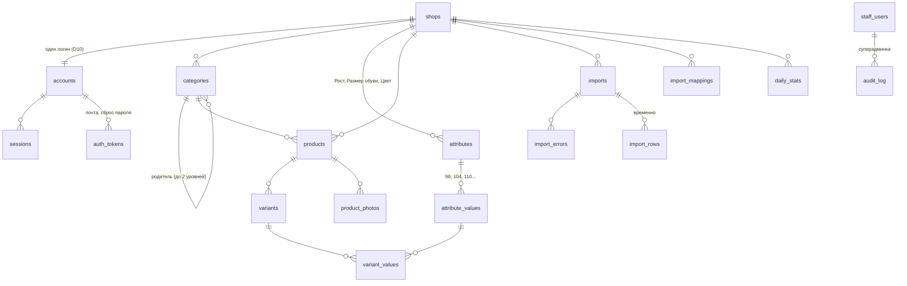

# Модель данных

База — PostgreSQL, доступ через Drizzle ([ADR 0001](adr/0001-stack.md)). Основа: [requirements.md](../01-product/requirements.md), [mvp-scope.md](../01-product/mvp-scope.md) (D14 — заказы не храним), экраны [admin.md](../04-design/admin.md) и [storefront.md](../04-design/storefront.md).

Развилки решены основателем 2026-10-31 (DM1–DM4, см. в конце).

## Общие правила
- **Мультиарендность:** одна база, у всех данных магазина есть `shop_id`. Каждый запрос в API фильтруется по магазину текущей сессии или поддомену витрины. Row Level Security в PostgreSQL как вторую линию защиты (NFR-4) можно включить позже, схема это позволяет.
- **Идентификаторы:** UUID v7 — упорядочены по времени, не угадываются, не выдают число записей (DM1).
- **Деньги:** целые тенге, `integer` (тиынов в рознице нет). Остаток — `integer ≥ 0`.
- **Время:** `timestamptz` в UTC; у магазина свой часовой пояс для графика и статистики (NFR-6), по умолчанию `Asia/Almaty`.
- **Тексты для покупателя** (название, описание) хранятся как ввёл магазин, без перевода. Переводятся только надписи интерфейса (Lingui).
- **Удаление:** товары, категории, фото удаляются физически; отсутствие артикула в импорте не удаляет, а обнуляет остаток (FR-A3). Аккаунт магазина — мягкая блокировка статусом.
- **Покупателей и заказов нет** (D11, D14). Корзина живёт в браузере (S10).

## Схема

## Таблицы

### Магазин и доступ

**shops** — магазин (FR-A2, FR-A9, FR-A8, FR-S2)
| Поле | Тип | Заметки |
|---|---|---|
| id | uuid | |
| subdomain | text, unique | латиница, цифры, дефис, 3–30; список зарезервированных слов проверяется в коде |
| name | text | |
| logo_key | text, null | ключ в хранилище фото |
| description | text, null | |
| whatsapp | text | номер в формате E.164, `+7…` |
| instagram | text, null | |
| address, how_to_find | text, null | «как найти» — необязательно |
| schedule | jsonb | 7 дней: `{ mon: { open: "10:00", close: "20:00" } \| null, … }`, `null` — выходной |
| timezone | text | `Asia/Almaty` |
| status | enum | `draft` / `published` / `blocked` |
| stock_display | enum | `levels` (есть / мало / нет) / `exact` |
| low_stock_threshold | smallint | по умолчанию 2 |
| show_out_of_stock | boolean | по умолчанию false |
| published_at, created_at, updated_at | timestamptz | |

**accounts** — логин магазина (FR-A1, D10). Отдельно от `shops`, чтобы позже добавить сотрудников без переделки.
| Поле | Тип | Заметки |
|---|---|---|
| id | uuid | |
| shop_id | uuid → shops, unique | один логин на магазин в MVP |
| email | citext, unique | |
| password_hash | text | argon2 |
| email_verified_at | timestamptz, null | |
| created_at | timestamptz | |

**sessions** — сессии входа (cookie). `id` (случайный токен, хранится хеш), `account_id`, `expires_at`, `created_at`, `user_agent`, `ip`. Для входа суперадмина «от имени» — `impersonated_by → staff_users` (FR-S3).

**auth_tokens** — одноразовые ссылки: `id`, `account_id`, `purpose` (`verify_email` / `reset_password`), `token_hash`, `expires_at`, `used_at`.

### Каталог

**categories** (FR-A6)
| Поле | Тип | Заметки |
|---|---|---|
| id | uuid | |
| shop_id | uuid | |
| parent_id | uuid, null | до 2 уровней — проверка в коде |
| name | text | unique в пределах (shop_id, parent_id) |
| path | text | `Девочки / Куртки` — для сопоставления при импорте |
| position | integer | порядок на витрине |

**attributes** — свойства вариантов: Рост, Размер обуви, Цвет (FR-A6, D4)
| Поле | Тип | Заметки |
|---|---|---|
| id | uuid | |
| shop_id | uuid | |
| name | text | unique в магазине |
| position | integer | |
| in_filters | boolean | показывать в фильтрах витрины |

**attribute_values** — `id`, `attribute_id`, `value` (text, unique в атрибуте), `position` (порядок 92 < 98 < 104; для новых значений из импорта — числовые сортируются по числу, остальные в конец).

**products** — карточка (FR-A5)
| Поле | Тип | Заметки |
|---|---|---|
| id | uuid | |
| shop_id | uuid | |
| category_id | uuid, null | без категории — если категорию удалили |
| name | text | |
| description | text, null | |
| is_visible | boolean | скрытый и «черновик» — это `false` |
| group_key | text, null | «Код товара» из импорта; если пусто — нормализованное название (FR-A3) |
| slug | text | из названия, для адреса на витрине |
| short_id | text | 5–6 символов base36, unique в магазине — по нему ищем товар по адресу |
| manual_fields | text[] | поля, правленные вручную, импорт их не перезаписывает: `description`, `is_visible` (FR-A3) |
| min_price, total_stock | integer | денормализация для списка и сортировки; пересчитываются при изменении вариантов |
| created_at, updated_at | timestamptz | `created_at` — сортировка «новые» |

**variants** — конкретная позиция, ключ импорта (FR-A3)
| Поле | Тип | Заметки |
|---|---|---|
| id | uuid | |
| shop_id | uuid | дублируем для уникальности артикула |
| product_id | uuid | |
| sku | text | unique (shop_id, sku); генерируется, если не задан вручную |
| barcode | text, null | |
| price | integer | тенге |
| stock | integer ≥ 0 | |
| position | integer | |

**variant_values** — значения атрибутов варианта: `variant_id`, `attribute_value_id`; PK (variant_id, attribute_value_id). Один вариант — не больше одного значения каждого атрибута (проверка в коде). У товара без размеров ровно один вариант без значений.

**product_photos** (FR-A4)
| Поле | Тип | Заметки |
|---|---|---|
| id | uuid | |
| product_id | uuid | |
| position | integer | 0 — обложка |
| original_key | text | исходник в хранилище |
| sizes | jsonb | `{ "320": "key", "640": "key", "1280": "key" }` в WebP/AVIF |
| width, height | integer | для правильного соотношения до загрузки |
| status | enum | `processing` / `ready` / `failed` |

### Импорт

**imports** — история (FR-A3)
| Поле | Тип | Заметки |
|---|---|---|
| id | uuid | |
| shop_id | uuid | |
| file_key, file_name | text | исходный файл храним для истории |
| status | enum | `uploaded` → `mapping` → `previewed` → `applying` → `done` / `failed` |
| mapping | jsonb | колонка файла → поле или атрибут |
| zero_missing | boolean | обнулить остаток артикулов, которых нет в файле |
| stats | jsonb | `{ rows, created, updated, zeroed, errors }` |
| created_at, finished_at | timestamptz | |

**import_errors** — `import_id`, `row_number`, `column`, `message`. Строки с ошибками пропускаются.

**import_mappings** — запомненные сопоставления (FR-A3): `shop_id`, `headers_hash` (по набору заголовков файла), `mapping` jsonb, `updated_at`. Следующий файл с теми же заголовками проходит без шага «Колонки».

**import_rows** — временные строки разобранного файла (DM2): `import_id`, `row_number`, `data` jsonb (значения после сопоставления), `action` (`create` / `update` / `skip`), `variant_id` null. Предпросмотр и применение работают с одними и теми же строками, применение — одной транзакцией; после `done` / `failed` строки удаляются.

### Статистика

**daily_stats** — счётчики по дням (FR-A10, FR-S1)
| Поле | Тип | Заметки |
|---|---|---|
| shop_id | uuid | |
| date | date | по часовому поясу магазина |
| product_id | uuid, null | `null` — по витрине в целом |
| views | integer | |
| order_clicks | integer | нажатия «Заказать через WhatsApp» |

PK (shop_id, date, product_id). Пишем `INSERT … ON CONFLICT DO UPDATE SET views = views + 1`. Сырых событий не храним — нет персональных данных и таблица не растёт (DM4). Ботов и повторные просмотры отсекаем по User-Agent и cookie на сутки.

### Суперадминка

**staff_users** — наши сотрудники: `id`, `email`, `password_hash`, `created_at`. Отдельно от магазинов.

**audit_log** — `id`, `staff_user_id`, `shop_id`, `action` (`block`, `unblock`, `impersonate`, …), `payload` jsonb, `created_at` (FR-S3).

> Примечание (2026-11-09, T-402, уточнения по контракту при переносе в схему Drizzle; схема — `apps/api/src/core/db/schema`, миграции — `apps/api/drizzle`):
> - **shops:** `name`, `subdomain`, `whatsapp` необязательные — их заполняет мастер после регистрации (в контракте `Shop` они `null`); добавлено `setup_completed` (мастер пройден, `Me.shop.setupCompleted`). `show_out_of_stock` по умолчанию `false`, как выше.
> - **accounts, staff_users:** почта — `text` с уникальным индексом по `lower(email)` вместо `citext` (без расширения PostgreSQL); код хранит её в нижнем регистре.
> - **sessions:** `id` — хеш токена из cookie. Сессии сотрудников — отдельная таблица `staff_sessions` (cookie `staff_sid`).
> - **uploads** — новая таблица для API2: выданные ссылки на загрузку (`purpose`, `key`, `file_name`, `content_type`, `size`, `expires_at`, `used_at`); по ней API проверяет `uploadId` (`upload_not_found`).
> - **products:** ~~`manual_fields`~~ → `imported_fields` (`name` / `category` / `variants`) — как `Product.importedFields` в контракте: какие поля перезапишет следующий импорт (описание и видимость импорт не трогает, FR-A3). Добавлено `max_price` (для «от X ₸»). `shop_id` продублирован и в `attribute_values`, `product_photos` — каждый запрос фильтруется по магазину без соединений (`backend-structure.md`, раздел 6).
> - **variant_values:** удаление значения свойства снимает его с вариантов каскадом (так в `deleteAttribute`); запрет удалить используемое значение (409 `attribute_value_in_use`) — в сервисе. Внешний ключ без каскада ломал удаление магазина (`06-process/pitfalls.md`). Родитель категории — без каскада: категорию с подкатегориями база удалить не даст (A28).
> - **imports** — поля как у `Import` в контракте: статусы `parsing … cancelled`, `row_count`, `headers`, `sample_rows`, `mapping`, `mapping_remembered`, `zero_missing`, `preview`, `result`, `failure_code` вместо `stats`; незаконченный импорт у магазина один (частичный уникальный индекс). **import_errors:** `row`, `column`, `value`, `code` (как `ImportRowError`) вместо `message`.
> - **daily_stats:** вместо первичного ключа — `unique nulls not distinct (shop_id, date, product_id)`: в первичном ключе не может быть `NULL`.
> - **preview-токен** витрины — без таблицы (решается в T-404).
> - UUID v7 по умолчанию — функция `uuidv7()` PostgreSQL 18: база в продакшене тоже должна быть 18+ (T-601).
> - Тарифов в схеме нет (D16).

## Адрес товара на витрине
`/<slug>-<short_id>`, например `/kurtka-demisezonnaya-7f3k2` (DM3): читаемо в ссылке и не ломается при переименовании — товар ищем по `short_id`, а если slug устарел, отвечаем редиректом 301 на актуальный адрес.

## Чего здесь нет (и почему)
- Заказов, покупателей, корзины — D11, D14, S10.
- Переводов названий товаров — магазин пишет на своём языке.
- Истории цен и остатков — не нужно для MVP.
- Нескольких логинов и ролей — D10 (таблица `accounts` уже позволяет добавить позже).
- Своих доменов магазинов — позже (D12), добавится таблица `domains`.

## Решения (2026-10-31)
| # | Вопрос | Решение |
|---|---|---|
| DM1 | Идентификаторы | UUID v7 |
| DM2 | Строки импорта между предпросмотром и применением | Временная таблица `import_rows`, применение одной транзакцией |
| DM3 | Адрес товара на витрине | `/<slug>-<short_id>`, поиск по `short_id`, 301 на актуальный slug |
| DM4 | Статистика | Счётчики по дням `daily_stats`, без сырых событий |
